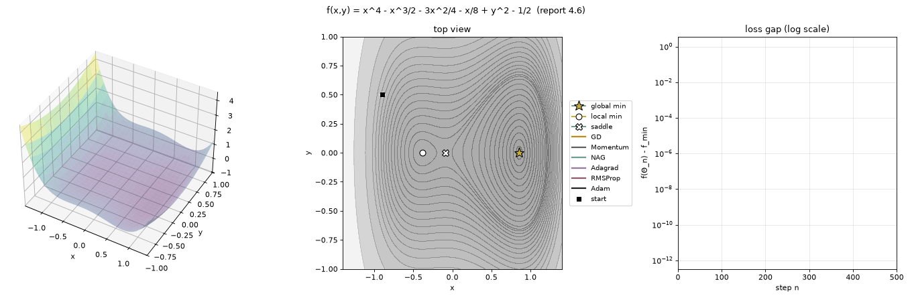

# Optimizer Visualize

이우고등학교 수학과제연구 보고서 **「The Review of Optimizer in Deep Learning」(2024)** 의 코드를 복원하고 개량한 프로젝트입니다.
보고서 원문(PDF)은 저장소에 포함하지 않았습니다.

**웹에서 바로 보기: https://<아이디>.github.io/optimizer-visualize/**: 설치 없이 브라우저에서 함수, 옵티마이저, 출발점, 학습률을 골라 애니메이션으로 비교할 수 있습니다.



```
original/                         보고서 코드를 그대로 복원 (실행 가능하도록 최소 수정)
  ch3_gradient_descent_compare.py   3.5  선형 회귀에서 BGD / SGD / mBGD 비교
  ch4_optimizer_visualize.py        4.6  옵티마이저들의 3D 시각화
optviz/                           개량판
  functions.py     손실 함수 (sympy로 정의 → 편미분·임계점 자동 계산)
  optimizers.py    GD, Momentum, NAG, Adagrad, RMSProp, Adam (+ Nadam)
  visualize.py     3D 곡면 + 등고선 + 손실 그래프, 애니메이션(GIF/MP4)
  regression.py    3.5 개량판
  experiments.py   β1 비교, 시작점별 도착 지도, 학습률×β1 지도
results/          python -m optviz all 로 만든 그림들
web/
  app.html         웹 시각화 원본 (HTML 파일 하나, 라이브러리 없음)
  build_pages.py   app.html → docs/index.html (GitHub Pages용)
docs/index.html   GitHub Pages로 배포되는 페이지 (직접 수정하지 말 것)
DEPLOY.md         GitHub 저장소 · Pages 배포 가이드
```

## 실행

```bash
uv venv .venv && uv pip install --python .venv/bin/python -r requirements.txt   # 또는 python -m venv .venv && .venv/bin/pip install -r requirements.txt
source .venv/bin/activate

# 원본
python original/ch3_gradient_descent_compare.py
python original/ch4_optimizer_visualize.py

# 개량판
python -m optviz landscape                       # 보고서 4.6 (창으로 표시)
python -m optviz landscape --animate             # 애니메이션
python -m optviz landscape --beta1 0.99 --steps 1000
python -m optviz landscape -f rosenbrock -o GD,Momentum,Adam,Nadam
python -m optviz regression --report-data        # 보고서 3.5 (보고서에 실린 데이터 사용)
python -m optviz basin                           # 시작점별 도착 지도
python -m optviz hparam                          # 학습률 × β1 지도
python -m optviz all                             # 모든 그림을 results/ 에 저장
```

`--save 파일명.png`(애니메이션은 `.gif`/`.mp4`)을 붙이면 창 대신 파일로 저장합니다. 명령별 옵션은 `python -m optviz <명령> -h`.
손실 함수(`-f`): `report`(보고서 4.6의 함수), `bowl`(길쭉한 그릇), `saddle`(안장점), `rosenbrock`.

## 원본 복원 노트

보고서 PDF의 코드를 옮겨 적었습니다. 결과 재현을 위해 **동작은 바꾸지 않았고**, 실행이 안 되는 부분만 고쳤습니다(`[복원 수정]` 주석).

| 위치 | 수정 내용 |
|---|---|
| ch3 `batchW`, `batchB` | `-2(y[i]-y_t[i])` → `-2*(...)`, 닫는 괄호 누락 |
| ch4 `target_f` | `–3/4`(en dash) → `-3/4` |
| ch4 마지막 | 반복이 끝나도 창이 닫히지 않게 `plt.ioff(); plt.show()` 추가 |

복원한 ch4 코드는 보고서 결론과 **같은 결과**를 냅니다. Momentum·NAG는 최솟값 (0.856, 0)에 도착하고, GD·RMSProp·Adam은 극솟값 (−0.386, 0)에 갇히며, Adagrad는 500스텝 안에 도착하지 못합니다.

### 원본에서 발견한 문제 (`[알려진 문제]` 주석)

1. **ch3: 예측값 배열이 정수형**: `y_t = np.full((3, 12), 0)`은 int 배열이라, 예측값의 소수점 아래가 잘려서 저장됩니다.
   보고서 데이터로 확인하면 BGD의 편향이 정답(최소제곱해) b = −0.18이 아니라 **b ≈ 0.22로 수렴**합니다. (`0.0`이나 `dtype=float`로 고치면 b = −0.18)
2. **ch3: epoch 기준이 서로 다름**: 세 방법 모두 epoch당 12번 업데이트합니다. 그래서 BGD는 전체 데이터를 12번 보고, mBGD는 같은 미니 배치를 3번씩 봅니다.
   개량판은 "1 epoch = 데이터 전체를 한 번 보기"로 통일했습니다. 이 기준에서는 BGD가 epoch당 1번만 업데이트하므로 epoch 기준으로는 가장 느립니다. 교과서에서 말하는 비교가 바로 이 기준입니다.
3. **ch4: NAG 첫 스텝**: `nag_sets[0] = start_point + momentum_delta[0]`. `doMoment = 0`이면 초기화되지 않은 값을 씁니다.
4. **ch4: 느린 그래디언트 계산**: 매 스텝 sympy `subs`로 기호 계산을 합니다. 개량판은 `lambdify`한 도함수를 써서 한 점 기준 약 10배 빠르고, 여러 점을 배열로 한 번에 계산할 수 있습니다.
5. **ch4: 그리는 범위**: [−5, 5]에서는 z가 600까지 커져서, 경로가 움직이는 [−1, 1] 영역이 거의 보이지 않습니다.
6. 그 밖에 본문은 EPOCH = 500이라고 하지만 코드는 100이고, 그래프 축 이름이 `'Eopchs'`, `'delta of w, b'`(실제로는 w, b 값)로 되어 있습니다.

## 개량한 점

- **구조**: 옵티마이저를 클래스로 분리해서 "옵티마이저마다 `if doXXX:` 블록 3개씩" 반복되던 코드를 없앴습니다. 새 옵티마이저는 `delta()` 하나만 구현하면 추가됩니다. (예: `Nadam`)
- **벡터화**: 모든 연산이 원소별(⊙) 연산이라, 시작점이나 하이퍼파라미터 수만 개를 한 번에 돌릴 수 있습니다. 아래의 지도 실험이 그렇게 만들어졌습니다.
- **수학**: 그래디언트 = 0을 sympy로 풀고 **헤시안 고윳값**으로 최솟값·극솟값·안장점을 자동 분류합니다.
- **시각화**: 3D 곡면, 위에서 본 등고선(임계점 표시), 로그 스케일 손실 그래프를 한 화면에 그립니다. 애니메이션은 GIF/MP4로 저장할 수 있습니다.
- **3장**: 최소제곱해(정답)를 함께 표시하고, (w, b) 파라미터 공간의 MSE 등고선 위에 경로를 그려 4장과 연결했습니다. seed로 재현할 수 있습니다.
- **손실 함수 추가**: 길쭉한 그릇(GD의 지그재그, Momentum의 가속), 안장점(기울기 소실), Rosenbrock.

## 새로 알게 된 점: 보고서 결론 다시 보기

보고서는 시작점 (−0.9, 0.5), η = 0.01 **한 조건**에서 결론을 냈습니다. 같은 실험을 많은 조건에서 반복해 보면 다음과 같습니다.

**1. "어느 옵티마이저가 극솟값을 탈출하는가"는 시작점에 크게 좌우됩니다.** (`results/basin_report.png`)
121×121개의 시작점에서 500스텝을 돌렸을 때 최솟값에 도착한 비율은 다음과 같습니다.

| GD | Momentum | NAG | Adagrad | RMSProp | Adam |
|---|---|---|---|---|---|
| 53% | 76% | 74% | 9% | 54% | 54% |

GD·RMSProp·Adam은 사실상 "안장점 x ≈ −0.095의 어느 쪽에서 출발하는가"로 결과가 정해집니다.
Momentum·NAG는 관성 덕분에 왼쪽 먼 곳(x < −0.8)에서 출발하면 극솟값을 넘어갑니다. 보고서의 시작점은 마침 이 영역에 있었습니다.
반대로 극솟값 근처(−0.8 < x < −0.1)에서 출발하면 Momentum·NAG도 갇힙니다.

**2. "Adam은 β1 = 0.99로 바꾸면 최솟값을 찾는다"는 경계에 걸친 불안정한 결과입니다.** (`results/hparam_adam_report.png`)
- β1 = 0.99, η = 0.01은 500스텝 시점에 아직 x ≈ 0.74에서 진동 중이고, **약 660스텝**이 지나야 최솟값 근처(거리 0.05 이내)에 정착합니다. 주변 설정을 조금만 바꿔도 결과가 들쭉날쭉합니다.
- 오히려 **β1 = 0.9를 유지하고 η를 약 0.07 이상으로 올려도** 최솟값으로 갑니다. (η = 0.065까지는 극솟값에 갇힘) "탈출"을 결정하는 것은 β1 하나가 아니라 관성(β1)과 보폭(η)의 조합입니다.

**3. Adagrad는 학습률이 계속 줄어드는 문제가 뚜렷합니다.** 대부분의 시작점에서 500스텝 안에 어떤 극소점에도 도착하지 못합니다. 보고서 4.4에서 RMSProp이 나온 이유를 그대로 보여줍니다.

**4. 3장: 보고서 데이터의 정답은 w = 3.107, b = −0.180입니다.** η = 0.01, 100 epoch 기준으로 SGD는 정답 근처에서 흔들리고, mBGD는 거의 도착했으며, BGD(100번 업데이트)는 아직 b ≈ 0.82입니다.
